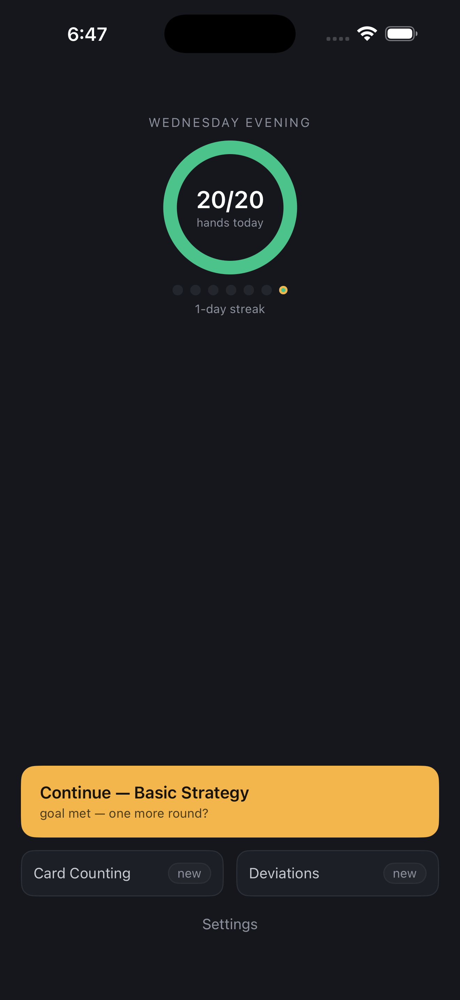
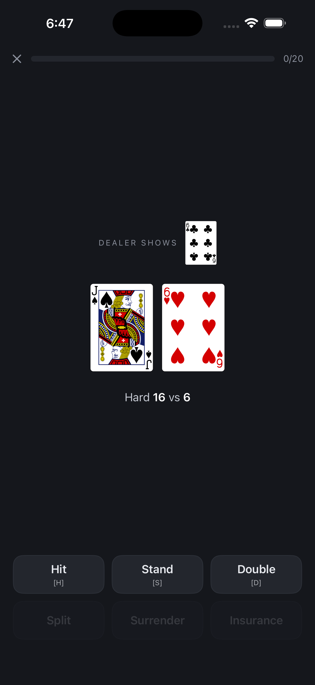
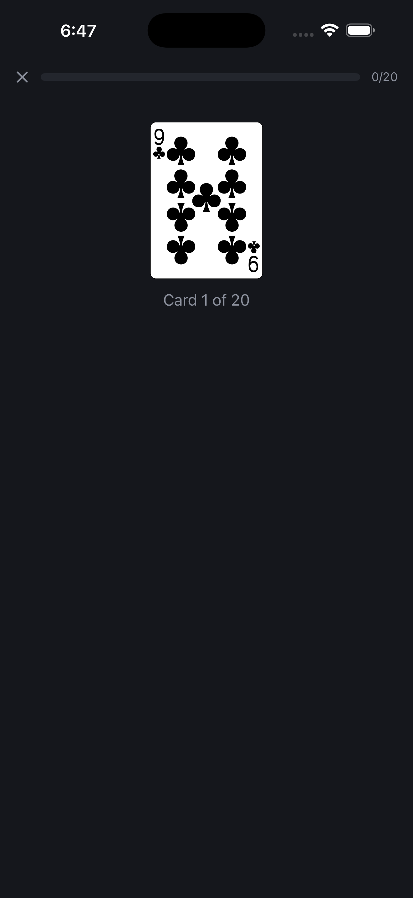
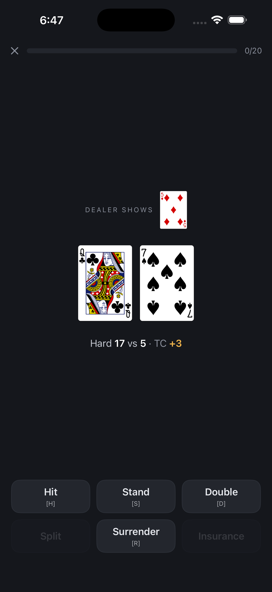

# Blackjack Trainer

A blackjack practice trainer that ships as two apps from one repository: an Angular progressive web app and a native SwiftUI iPhone app.
Both drill the same four skills against published Blackjack Apprenticeship charts, and both run entirely on the device: no backend, no account, no analytics.

<p align="center">
  
  
  
  
</p>

## What it does

- **Basic strategy.** Hands against the H17 and S17 charts, played out from the deal: a correct hit deals the next card and asks again, and a correct split plays both hands.
- **Running count.** Count a card stream of configurable length and speed, across 58 counting systems (Hi-Lo, KO, Omega II, Wong Halves and the Blackjack Review comparison set).
- **True count.** The same streams, answered as running count over decks remaining, from a fixed preset or a live, depleting shoe with deck estimation. A live-shoe round can roll into a showdown against the dealer.
- **Deviations.** Hands against the Hi-Lo H17 and S17 index charts, with the true count drawn at random or entered by hand to drill exact thresholds, plus insurance when the dealer shows an ace, asked before the play as a table asks it, so the ace-up indices get their own question.
- **The cost of a mistake.** Every miss says what it gave up: a coin flip the chart happened to call reads as one, and a split of tens reads as an eighth of the bet. Weak spots rank by cost rather than by count, and Progress prices the week's misses against the house edge at your rules.
- **The Flow shell.** A one-action home screen (continue, daily goal ring, 7-day streak), full-screen drills that auto-advance on correct answers and adapt to the hands you keep missing, a strategy-chart reference, and a progress page.

## How it is built

|             | Web                                                                     | iOS                                              |
| ----------- | ----------------------------------------------------------------------- | ------------------------------------------------ |
| UI          | Angular 22, standalone components, signals, zoneless                    | SwiftUI                                          |
| Engines     | Pure TypeScript services with no Angular runtime dependency             | Swift mirrors of the same engines                |
| Persistence | `localStorage` through one tolerant reader that degrades field by field | `UserDefaults` plus iCloud Key-Value Store       |
| Tests       | Vitest with enforced coverage floors, Playwright smoke suite            | XCTest, including parity tests                   |
| Tooling     | TypeScript 6 strict, Prettier, GitHub Actions                           | XcodeGen, SwiftFormat, SwiftLint, GitHub Actions |

**One set of engines, two platforms.** The TypeScript engines are the source of truth.
`npm run export:fixtures` serialises their decisions into `ios/Fixtures/*.json`, the Swift parity tests replay those vectors, and CI fails if the exported fixtures drift from the committed ones.

**Charts held to arithmetic.** `tools/ev/` is a combinatorial analyser that derives every play's value from the rules of the game and reads no chart.
Stand, hit and double are exact for the shoe; a split is exact without re-splitting, with the standard approximation for sibling hands past that.
It reproduces the published dealer tables and six-deck house edges, agrees with brute-force enumeration on small shoes, and agrees with 1.2 billion simulated hands played by the app's own engines.
Every chart cell is tested against it, and CI regenerates its table and fails on a difference.
The published deviation indices are held to depleted shoes sampled by true count, each solved exactly.

**Deterministic sessions.** Every random draw goes through one seam (`RANDOM_SOURCE`).
Appending `?seed=<integer>` to any URL replays a session exactly, which lets the end-to-end suite assert real outcomes rather than only that the flow advanced.

**Offline by design.** The web app is an installable PWA with a service worker, and the two legal pages ride in the bundle so they serve offline too.
Backups are a declared key list rather than a `localStorage` prefix sweep, because the app is built to ship on a shared GitHub Pages origin.

**iCloud writes are gated.** On iOS every cloud write waits for proof that the device completed an initial sync round trip, so a fresh install with an empty cache can never overwrite the shared state.

Charts come from [Blackjack Apprenticeship](https://www.blackjackapprenticeship.com/).
True count truncates toward zero on both platforms.
Values and costs are for a six-deck shoe.

## Run it

Node 22 (see `.nvmrc`).

```bash
npm install
npm start              # dev server at http://127.0.0.1:4200/
npm test               # unit tests (CI=true for a single run)
npm run lint           # tsc + prettier --check
npm run build          # production bundle in dist/blackjack-trainer/
npm run e2e:install    # once: download Chromium
npm run e2e            # Playwright smoke suite
```

iOS, from `ios/`:

```bash
xcodegen generate
xcodebuild -scheme BlackjackTrainer -destination 'platform=iOS Simulator,name=iPhone 16 Pro' build test
```

Device builds need a signing team: copy `ios/Config/Signing.local.xcconfig.example` to `Signing.local.xcconfig` and set `DEVELOPMENT_TEAM`.

## Repository map

```
src/app/
  core/services/   pure engines: strategy, counting, shoe, deviations, storage, the RNG seam
  core/models/     cards, hands, charts, counting systems, drill settings
  data/            the H17/S17 basic-strategy and deviation charts, 58 counting systems
  features/        home, drills, chart, progress, settings (lazy routes)
e2e/               Playwright smoke tests
ios/               SwiftUI app (XcodeGen project), parity tests, App Store collateral
ios/Fixtures/      parity vectors exported from the TypeScript engines
archived/          iOS features cut from the 1.0 build, with restore notes
tools/             the fixture exporter and the static server the E2E dist lane uses
tools/ev/          the solver, the true-count sampler and the value-table exporters
```

## License

Application code is MIT (see `LICENSE`).
The card SVGs under `public/cards/` are Chris Aguilar's Vector Playing Card Library via [cardsJS](https://github.com/richardschneider/cardsJS), LGPL 3.0, with the upstream notices committed alongside them.
